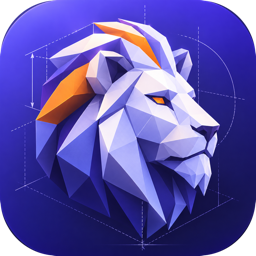

<p align="center">
  
</p>

<h1 align="center">leocad</h1>

<p align="center">
  <b>Free, open-source parametric CAD for makers</b><br>
  Runs locally on your Mac — no account, no cloud.
</p>

<p align="center">
  <a href="../../releases/latest">Download for macOS</a> ·
  <a href="#install-macos">Install guide</a> ·
  <a href="docs/FORMAT.md">File format</a> ·
  <a href="#let-claude-drive-it-mcp">MCP</a>
</p>

Constraint-based sketches, extrude/revolve/fillet/chamfer/shell/ISO threads/patterns/mirror/booleans, direct
push/pull editing with drag handles, STEP/STL/3MF/DXF/SVG, and an MCP server so Claude can model for you.

## Install (macOS)

1. Download the latest `.dmg` from the [Releases](../../releases) page (`arm64` = Apple Silicon, `x64` = Intel).
2. Open it and drag **leocad** into **Applications**, then start it. The app is signed and notarized by Apple.

Every push to `main` publishes a fresh build as the **latest** pre-release; tags `v*` create versioned releases.
The app checks for new releases at start and hourly and offers **Update now** — it downloads the new
version, replaces itself and restarts (also available via *leocad → Check for Updates…*).

## Your files

Projects are plain `.leocad` files in a folder you pick on first launch (default `~/Documents/leocad`,
changeable in Settings). Folders you create in the app are real folders there. The files are human-readable JSON (see
[docs/FORMAT.md](docs/FORMAT.md)) that you can version with git, edit by hand or generate with scripts.
Exchange with other CAD tools via STEP; 3D printing via STL/3MF; laser cutting via DXF/SVG.

## Let Claude drive it (MCP)

The desktop app accepts assistant connections out of the box (switch it off via the plug icon).
Click the plug icon to copy the configuration for Claude Desktop (Settings → Developer → Edit Config)
or the `claude mcp add …` command for Claude Code; the assistant starts the MCP server itself and you
watch it work live in the app — including previews of ideas before they are applied. Tools: `get_guide`, `get_model`, `get_sketch`,
`apply_ops`, `preview_ops`, `undo`/`redo`, project management, `render_view`, `set_view`,
`measure`, `export`, `status`. The bridge only listens on `127.0.0.1`.

## Develop

```bash
pnpm install
pnpm dev                                   # web app at http://localhost:5173
pnpm --filter leocad-desktop dev          # desktop shell against the dev server
pnpm --filter leocad-desktop run dist     # build the .dmg locally
pnpm test && pnpm typecheck
```

## Layout

| Path | Contents | License |
|---|---|---|
| `packages/schema` | Document + Operations-API types and JSON Schema, validation | MIT |
| `packages/naming` | Persistent references: selector resolution, tag propagation | MIT |
| `packages/io` | STL/3MF/DXF/SVG writers & readers, share links | MIT |
| `packages/sketch` | PlaneGCS constraint solving, region detection | AGPL-3.0 |
| `packages/model` | Expressions, document store (undo/redo), incremental rebuild | AGPL-3.0 |
| `packages/kernel` | OpenCascade (WASM) modelling, tessellation, worker | AGPL-3.0 |
| `packages/viewport` | Three.js rendering, picking, drag handles | AGPL-3.0 |
| `packages/ai` | BYOK copilot loop and the modelling guide | AGPL-3.0 |
| `packages/mcp` | MCP server bridging assistants to the app | AGPL-3.0 |
| `apps/web` | The app (React) | AGPL-3.0 |
| `apps/desktop` | Electron shell for macOS | AGPL-3.0 |

See [docs/PLAN.md](docs/PLAN.md) for the roadmap.
