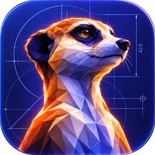

<p align="center">
  
</p>

<h1 align="center">meerCAD</h1>

<p align="center">
  <b>Parametric CAD for makers</b><br>
  Runs locally on your Mac — no account, no cloud.
</p>

<p align="center">
  <a href="#install-macos">Install</a> ·
  <a href="docs/FORMAT.md">File format</a> ·
  <a href="#let-claude-drive-it-mcp">MCP</a>
</p>

Constraint-based sketches, extrude/revolve/fillet/chamfer/shell/ISO threads/patterns/mirror/booleans, direct
push/pull editing with drag handles, STEP/STL/3MF/DXF/SVG, and an MCP server so Claude can model for you.

## Install (macOS)

- **Try a change on this Mac:** `pnpm wip` builds the working tree and installs it as *meerCAD WIP*
  in Applications, next to any installed meerCAD.
- **Testers:** `pnpm testflight` uploads iPhone and iPad builds to TestFlight.
- **Customers** get meerCAD from the App Store, which also delivers updates.

## Your files

Projects are plain `.meercad` files in a folder you pick on first launch (default `~/Documents/meerCAD`,
changeable in Settings). Folders you create in the app are real folders there. The files are human-readable JSON (see
[docs/FORMAT.md](docs/FORMAT.md)) that you can version with git, edit by hand or generate with scripts.
Exchange with other CAD tools via STEP; 3D printing via STL/3MF; laser cutting via DXF/SVG.

## Let Claude drive it (MCP)

The desktop app accepts assistant connections out of the box (switch it off via the plug icon).
Click the plug icon to copy the configuration for Claude Desktop (Settings → Developer → Edit Config)
or the `claude mcp add …` command for Claude Code; the assistant starts the MCP server itself and you
watch it work live in the app — including previews of ideas before they are applied. Tools: `get_guide`, `get_model`, `get_sketch`,
`apply_ops`, `preview_ops`, `undo`/`redo`, project management, `render_view`, `set_view`,
`measure`, `export`, `status`. The bridge only listens on `127.0.0.1`.

## Develop

```bash
pnpm install
pnpm dev                                   # web app at http://localhost:5173
pnpm --filter meercad-desktop dev          # desktop shell against the dev server
pnpm --filter meercad-desktop run dist     # build the .dmg locally
pnpm test && pnpm typecheck
```

### Try it on an iPad

```bash
pnpm ipad                                  # production build, served on your local network
```

Vite prints a `Network:` address such as `http://192.168.1.20:4173`. Open it in Safari on an iPad
on the same Wi-Fi. Judge speed only on this build: `pnpm dev:lan` (port 5173) reloads on every
change but runs React's much slower development mode and loads hundreds of separate modules.

| Gesture | Does |
| --- | --- |
| Pencil or finger tap | Select; further taps add to the selection, a tap on empty space clears it |
| Pencil double tap | Select the whole part |
| Finger double tap on a face | Turn the view to look straight at it |
| Hold (finger or Pencil) | Context menu, like a right click on the Mac |
| Hold, then drag | Area selection (drag right: fully inside, drag left: touching) |
| One finger drag | Orbit |
| Two finger drag / pinch | Pan / zoom |
| Three finger swipe left / right | Undo / redo (a two / three finger tap does the same) |
| Double tap on the view cube | Back to the isometric view |

The Pencil draws in sketches and drags the arrows; on iPads that sense a hovering Pencil the snap
dot shows before the tip touches. Until a Pencil touches the screen a finger tap also places points
in a sketch; after that only the Pencil draws. Fingers resting on the screen while the Pencil is
down are ignored. Over plain `http` on the network the page is not cross-origin isolated; the
modelling kernel does not need that. Copying a share link falls back to a dialog there because
Safari only allows the clipboard on `https`.

### iPad app

`apps/ios` wraps the web app with Capacitor. Needs Xcode; signing uses the Apple account signed in
to Xcode (Settings › Accounts).

```bash
pnpm ios                                   # builds the web app, syncs it into the Xcode project, opens Xcode
```

In Xcode pick your iPad (cable or same Wi-Fi) or a simulator and press Run. In the app, projects are
`.meercad` files in the Files app under On My iPad › meerCAD, and tapping one there opens it in
meerCAD. Exports open the share sheet. A double tap (Apple Pencil 2 and Pro) or squeeze (Pro) in a
sketch switches between Select and the drawing tool used last. The kernel runs single-threaded in
the app.

## Layout

| Path | Contents | License |
|---|---|---|
| `packages/schema` | Document + Operations-API types and JSON Schema, validation | MIT |
| `packages/naming` | Persistent references: selector resolution, tag propagation | MIT |
| `packages/io` | STL/3MF/DXF/SVG writers & readers, share links | MIT |
| `packages/sketch` | PlaneGCS constraint solving, region detection | FSL-1.1 |
| `packages/model` | Expressions, document store (undo/redo), incremental rebuild | FSL-1.1 |
| `packages/kernel` | OpenCascade (WASM) modelling, tessellation, worker | FSL-1.1 |
| `packages/viewport` | Three.js rendering, picking, drag handles | FSL-1.1 |
| `packages/ai` | BYOK copilot loop and the modelling guide | FSL-1.1 |
| `packages/mcp` | MCP server bridging assistants to the app | FSL-1.1 |
| `apps/web` | The app (React) | FSL-1.1 |
| `apps/desktop` | Electron shell for macOS | FSL-1.1 |

See [docs/PLAN.md](docs/PLAN.md) for the roadmap.

## License

meerCAD is free to use, for hobby and commercial work alike, and its source is open to read,
modify and contribute to. It is licensed under the [Functional Source License 1.1](LICENSE)
(FSL-1.1-ALv2): you may do anything with it except build a competing product or service from it.
Two years after each release, that release automatically becomes available under the Apache
License 2.0 as well.

- The file-format, I/O and naming libraries (`packages/schema`, `packages/io`, `packages/naming`)
  are MIT, so other tools can read and write `.meercad` files freely.
- Versions published before 27 October 2026 (the leocad releases) remain under the GNU AGPL-3.0.
- Third-party components keep their own licenses; see [THIRD_PARTY_NOTICES.md](THIRD_PARTY_NOTICES.md).
- The name **meerCAD** and the meerkat logo are trademarks; see [TRADEMARKS.md](TRADEMARKS.md).

Your models are yours: nothing in the license applies to what you design with meerCAD.
